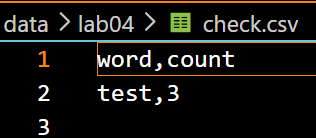
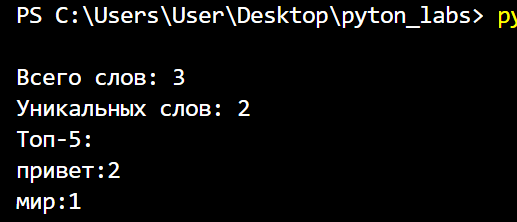
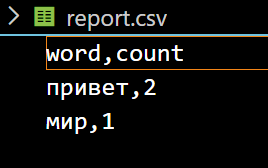
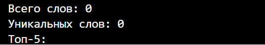
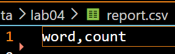
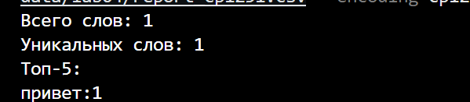
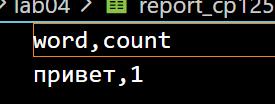

## Лабораторная работа №4    

**Задание A — io_txt_csv.py**    
*Функции read_text и write_csv (запись с проверкой длины строк).*   
результат мини-теста    
     

**Задание B - text_report.py**
*Читает текст, считает частоты (lib.text), сортирует (count ↓, слово ↑) и создаёт CSV. Выводит Топ-5 в консоль.*    
Тест A  
  

Тест В    
   

Тест С     
  