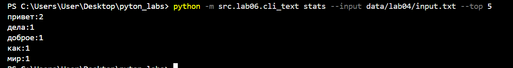
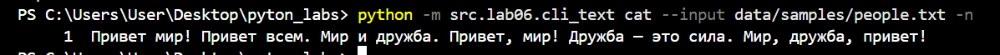
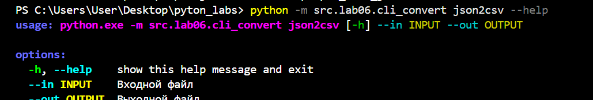
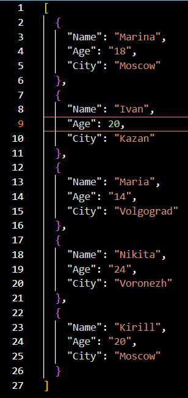
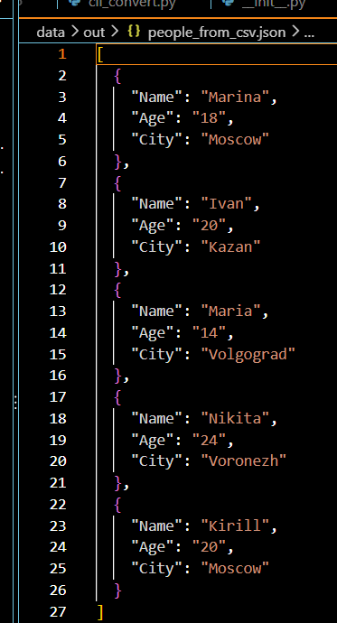
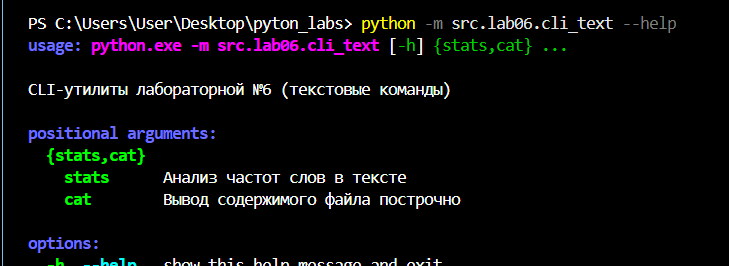
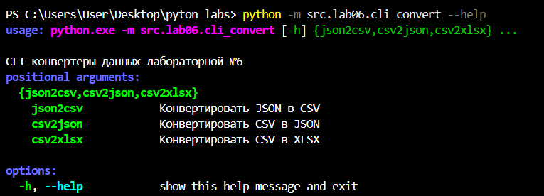

# Отчет по лабораторной работе №6
## Задание 1 — текстовые CLI-утилиты


### Подкоманда `stats`

Подкоманда подсчитывает частоты слов в текстовом файле. Для обработки
используются функции из [src/lib/text.py](../lib/text.py):


Запуск с количеством слов по умолчанию:

```powershell
python -m src.lab06.cli_text stats --input data/samples/people.txt
```

Выводит топ-5 самых часто встречающихся слов в тексте:

```powershell
python -m src.lab06.cli_text stats --input data/lab04/input.txt --top 5


Пример запуска кода (вывод топ 5):

[]

Параметры:

- `--input` — обязательный путь к текстовому файлу;
- `--top` — количество слов в результате, по умолчанию `5`.

### Подкоманда `cat`

Подкоманда выводит текст без нумерации.

```powershell
python -m src.lab06.cli_text cat --input data/samples/people.txt
```

Вывод текста с нумерацией строк (флаг -n):

```powershell
python -m src.lab06.cli_text cat --input data/samples/people.txt -n
```

Пример запуска для вывода с нумерацией:



Параметры:

- `--input` — обязательный путь к входному файлу;
- `-n` — необязательный флаг нумерации строк.

## Задание B — CLI-конвертеры


### Подкоманда `json_to_csv`

Преобразует JSON со списком словарей в CSV:

```
Справка к json_to_csv



Пример для запуска подкоманды:



Результат запуска:


### Подкоманда `csv_to_json`  

Преобразует CSV с заголовком в JSON-список словарей:

Результат запуска:



### Подкоманда `csv2xlsx`

Преобразует CSV в таблицу XLSX:

Результат запуска:


## Справка `--help`


Справка текстовых подкоманд:



Справка конверторов:



## Обработка ошибок

При отсутствии входного файла программы вызывают `FileNotFoundError` с понятным сообщением о пути к файлу.

Ошибки формата входных файлов и пустых файлов обрабатываются функциями из лабораторных работ №4 и №5. Ошибки обязательных аргументов и неизвестных параметров обрабатываются самим `argparse`, который выводит сообщение об ошибке и справку по использованию команды.


